Architecture overview
=====================

``cantools`` separates the description of CAN data from the data itself. A database file is loaded once and converted into a Python object. This object contains all rules of the database: messages, signals, nodes and buses. All further work uses the object. It translates signal values into bytes and bytes into signal values, and it can be written back to a file.

   Overview of cantools. The colors are explained in the legend. Select the image to enlarge it.

Loading and parsing
-------------------

The database is the input. :func:`~cantools.database.load_file`, :func:`~cantools.database.load` and :func:`~cantools.database.load_string` load it. They differ in what they take: a file name, an open file object and a string.

Reading means getting the text out of the file. Parsing means converting this text into Python objects. :func:`~cantools.database.load_file` opens the file and passes it to :func:`~cantools.database.load`. :func:`~cantools.database.load` reads the content and passes it to :func:`~cantools.database.load_string`, which parses it with the code of the selected format.

The format is selected by the file name extension (``.arxml``, ``.dbc``, ``.kcd``, ``.sym``, ``.cdd``, not case sensitive) or by the ``database_format`` argument. If the format is unknown, :func:`~cantools.database.load_string` tries the formats one after another and raises :class:`~cantools.database.UnsupportedDatabaseFormatError` if none matches.

The Database object
-------------------

The result is a :class:`~cantools.database.can.Database` object. It contains the messages with their signals, the nodes and the buses of the database. Further information can be added to an existing object. The ``add_*_file``, ``add_*_string`` and ``add_*`` methods, for example :meth:`~cantools.database.can.Database.add_dbc_file`, parse another database and add its messages to the object. Nodes and version are taken from the added database and replace the previous ones.

Encoding and decoding
---------------------

The Database object is the set of rules for translating between signal values and bytes. :meth:`~cantools.database.can.Database.encode_message` and :meth:`~cantools.database.can.Database.decode_message` find the message by frame id or name and pass the work on to :meth:`~cantools.database.can.Message.encode` and :meth:`~cantools.database.can.Message.decode`. The frame id only selects the message. ``encode_message`` returns the data bytes of the frame, not the frame itself; ``decode_message`` takes the frame id and the data bytes. Decoding the frame from :doc:`can-databases` gives:

.. code-block:: python

   >>> db.decode_message(512, b'\x00\x00\x34\x00\x00\x00\x00\x00')
   {'Pressure': 0, 'Temperature': 12, 'Humidity': 0, 'Sensor_Status': 'Sensor OK'}

Writing databases
-----------------

The Database object can be written back to a file with :func:`~cantools.database.dump_file`. Only DBC, KCD and SYM can be written. The format is selected by the file name extension. :meth:`~cantools.database.can.Database.as_dbc_string`, :meth:`~cantools.database.can.Database.as_kcd_string` and :meth:`~cantools.database.can.Database.as_sym_string` return the same content as text.

ARXML
-----

ARXML is loaded into the same :class:`~cantools.database.can.Database` class as DBC. It can be read but not written. ``cantools`` reads only the communication part. AUTOSAR specific information is available in the ``autosar`` attributes of the database, message, node and bus objects, for example :class:`~cantools.database.can.formats.arxml.AutosarDatabaseSpecifics`.

Diagnostics (CDD)
-----------------

Diagnostic data (CDD) is loaded with the same functions, but into a separate class, :class:`~cantools.database.diagnostics.Database`. It cannot be written back. :meth:`~cantools.database.diagnostics.Did.encode` and :meth:`~cantools.database.diagnostics.Did.decode` encode and decode the data of a diagnostic data identifier (DID).

Command line
------------

The command line tool uses the same functions. The subcommands :ref:`convert <cli-convert>`, :ref:`decode <cli-decode>`, :ref:`plot <cli-plot>`, :ref:`monitor <cli-monitor>`, :ref:`dump <cli-dump>`, :ref:`list <cli-list>` and :ref:`generate_c_source <cli-generate_c_source>` all load the database with :func:`~cantools.database.load_file`. ``convert`` writes it with :func:`~cantools.database.dump_file`. ``decode`` and ``plot`` also read ``candump`` lines from standard input. ``monitor`` receives frames from a CAN interface through python-can. Arguments and options of all subcommands are listed in the :doc:`CLI reference <../reference/cli/commands>`.
